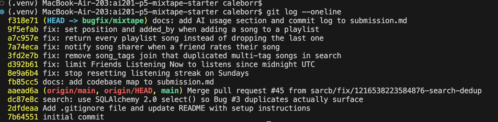

# Mixtape Bug Hunt — Submission

## AI Usage

I used **Claude Code (Claude Opus 5.5)** as an agent in my terminal for this project, which my AI201 course allows. To be clear about the collaboration: Claude did most of the hands-on navigation, reproduction, fixing, test writing, and first drafts of this document. I directed the work and reviewed the results. Specifically:

- **Codebase orientation.** Claude read `README.md`, `app.py`, `models.py`, every route and service, `seed_data.py`, and the existing tests before touching any issue, then drafted the codebase map. It was most useful for connecting things across files: for example, seeing that `playlist_entries` has NOT NULL `position`/`added_by` columns while `Playlist.songs` is a plain `secondary` relationship, and that notifications are created imperatively (no event hooks).
- **Reproduction before fixing.** Claude seeded the DB, ran the app, and reproduced each issue with real HTTP calls (`curl`) and, for the time-dependent bugs, small scripts with controlled timestamps: a Saturday-to-Sunday streak call for #1, and a 23:30-yesterday listen for #2. It ran the existing test suite first as a baseline (4 failing tests mapped to issues #1, #3, and #5). No code was changed until all five issues had reproduced.
- **Tracing and explaining.** Claude followed each route to its service and compared code paths. For #4 it compared `add_to_playlist()` and `rate_song()` side by side. For #3 it explained why an outer join on an association table multiplies rows.
- **Where claims had to be verified, not trusted:**
  - For #3, the explanation that "the legacy `Query` API de-duplicates entities but 2.0 `select().scalars()` doesn't" came partly from recall and partly from the earlier commit message in git history. We didn't rely on that alone: we ran the same join three ways against the seeded DB (raw SQL = 3 rows, legacy `Query` = 1, `select().scalars()` = 3) before writing it into the RCA.
  - For every fix, the new or updated test was run against the **original** code (by stashing the fix) to confirm it actually fails without the fix. A test that passes either way proves nothing.
  - The add-to-playlist 500 was **not** found by reading code. It only appeared when we actually ran Issue #5's step 2 ("add a song"), which is a good argument for reproducing bugs and not just pattern-matching the code.
  - A couple of early HTTP checks failed only because they ran before the Flask server had finished starting. We recognized these as harness timing problems, not app behavior, and re-ran them.
- **Fix design choices I agreed with:** removing the unnecessary join in #3 rather than adding `.distinct()` to hide duplicates; using UTC midnight in #2 to match the streak service's existing definition of a "day"; and mirroring the existing `add_to_playlist` notification pattern exactly in #4 rather than inventing a new mechanism.

I re-read each RCA entry, the diffs, and the test results before submitting.

---

## Git log (`bugfix/mixtape`)



```
9f5efab fix: set position and added_by when adding a song to a playlist
a7c957e fix: return every playlist song instead of dropping the last one
7a74eca fix: notify song sharer when a friend rates their song
3fd2e7b fix: remove song_tags join that duplicated multi-tag songs in search
d392b61 fix: limit Friends Listening Now to listens since midnight UTC
8e9a6b4 fix: stop resetting listening streak on Sundays
fb85cc5 docs: add codebase map to submission.md
# (followed by two docs commits: the AI usage section and this screenshot)
```

---

## Codebase Map

### Top level

- **`app.py`**: Flask application factory. `create_app(config=None)` builds the Flask app, configures SQLAlchemy (defaults to `sqlite:///mixtape.db`, which Flask-SQLAlchemy places in `instance/`), merges in any override config (the tests pass an in-memory SQLite URI), registers the four blueprints under `/songs`, `/playlists`, `/users`, and `/feed`, and runs `db.create_all()`. The module-level `db = SQLAlchemy()` object is imported by every model and service. This is why the app must be started with `FLASK_APP=app:create_app flask run` and not `python app.py`, which would import `app` twice.
- **`models.py`**: Seven SQLAlchemy models (`User`, `Tag`, `Song`, `ListeningEvent`, `Rating`, `Playlist`, `Notification`) and three association tables:
  - `friendships(user_id, friend_id)`: a self-referential many-to-many on `User`. Friendship is stored as **two rows**, one per direction. `User.friends` is a `lazy="dynamic"` relationship, so it returns a query instead of a list.
  - `song_tags(song_id, tag_id)`: many-to-many between `Song` and `Tag`. `Song.tags` loads it with `lazy="subquery"`, and `Song.to_dict()` serializes tags as a list of names.
  - `playlist_entries(playlist_id, song_id, position, added_by, added_at)`: a many-to-many **with payload**. Besides the two foreign keys it carries an explicit `position` (NOT NULL) and `added_by` (NOT NULL), so a playlist's order lives in this table and not in insertion order. `Playlist.songs` is a plain `secondary=` relationship over this table.
  - `User` stores denormalized streak state (`listening_streak`, `last_listened_at`), so the streak is computed when a listen is written, not when it is read.
  - `Rating` has a unique constraint on `(user_id, song_id)`: one rating per user per song, which is updated in place on re-rate.
  - Every model with a timestamp defaults it to `datetime.now(timezone.utc)`. SQLite stores these as naive strings, so values read back are naive UTC datetimes.
  - Each model has a `to_dict()` that the routes return as JSON.
- **`seed_data.py`**: Drops and recreates the DB, then inserts 5 users (nova, darius, simone, kenji, aaliya) with bidirectional friendships, 10 tags, 13 songs grouped by tag count (0, 1, or 3 tags), listening events spread from ~10 minutes to ~2.5 days in the past, 3 playlists of 7 songs each (positions 1–7, written straight into `playlist_entries`), and one sample `song_added_to_playlist` notification.
- **`tests/`**: pytest suites for streaks, search, and playlists. Each one builds a fresh app on `sqlite:///:memory:` and seeds its own fixtures.

### Routes layer (`routes/`): HTTP parsing and response formatting only

| File | Endpoints | Delegates to |
|---|---|---|
| `songs.py` | `GET /songs/search?q=`, `GET /songs/<id>`, `POST /songs/<id>/rate`, `POST /songs/<id>/listen` | `search_service.search_songs/get_song`, `notification_service.rate_song`, `streak_service.record_listening_event` |
| `playlists.py` | `POST /playlists/`, `GET /playlists/<id>`, `GET /playlists/<id>/songs`, `POST /playlists/<id>/songs` | `playlist_service.*`, `notification_service.add_to_playlist` |
| `users.py` | `GET /users/<id>`, `GET /users/<id>/streak`, `GET /users/<id>/notifications[?unread_only=true]`, `POST /users/notifications/<id>/read` | `streak_service.get_streak`, `notification_service.get_notifications/mark_as_read` |
| `feed.py` | `GET /feed/<id>/listening-now`, `GET /feed/<id>/activity` | `feed_service.get_friends_listening_now/get_activity_feed` |

### Services layer (`services/`): all business logic

- **`streak_service.py`**: `record_listening_event()` creates a `ListeningEvent` stamped with "now" (UTC) and calls `update_listening_streak(user, now)`, which compares the calendar date of `now` with the date of `user.last_listened_at`. A difference of 0 days means no change, 1 day increments the streak, and anything larger resets it to 1. `get_streak()` just reads the stored column.
- **`feed_service.py`**: `get_friends_listening_now()` gets the user's friend IDs, queries their `ListeningEvent`s newer than a cutoff, orders them newest first, and keeps only the first (most recent) event per friend. `get_activity_feed()` is the same query without the cutoff, limited to N events.
- **`search_service.py`**: `search_songs(q)` runs a 2.0-style `select(Song)` with a case-insensitive `ilike` on title or artist and returns `to_dict()` for each row, which includes tags. `get_song()` looks up a song by primary key.
- **`notification_service.py`**: Holds `create_notification()`, a generic helper that inserts and commits a `Notification`, plus the two song-interaction actions that may produce notifications: `add_to_playlist()` and `rate_song()`. Also contains `get_notifications()` (newest first, with an optional unread filter) and `mark_as_read()`.
- **`playlist_service.py`**: `create_playlist()`, `get_playlist()` (metadata only), `get_user_playlists()`, and `get_playlist_songs()`, which joins `Song` to `playlist_entries` and orders by `position` ascending.

### Data flow 1: a user rates a song

1. `POST /songs/<song_id>/rate` with body `{"user_id": ..., "score": ...}` hits `rate()` in `routes/songs.py`.
2. The route checks that both fields are present (400 otherwise), casts `score` to `int`, and calls `notification_service.rate_song(user_id, song_id, score)`.
3. `rate_song()` rejects scores outside 1–5 (`ValueError`), loads the `Song` and the rater `User` (each raises `ValueError` if missing), then looks for an existing `Rating` for `(user_id, song_id)`. If one exists it updates `score`; otherwise it adds a new `Rating`. Then it commits.
4. It returns the `Rating`. The route serializes it with `to_dict()` and responds 201. Any `ValueError` becomes a 400.

### Data flow 2: a friend adds a song to a playlist (the notifying path)

1. `POST /playlists/<playlist_id>/songs` with `{"song_id", "added_by"}` goes to `add_song()` in `routes/playlists.py`, which then calls `notification_service.add_to_playlist()`.
2. That function loads the song, the adding user, and the playlist, and appends the song to `playlist.songs` if it isn't already there.
3. If the song's `shared_by` is not the adder, it calls `create_notification(user_id=song.shared_by, notification_type="song_added_to_playlist", body=...)`. The sharer later sees it through `GET /users/<id>/notifications`.

### Data flow 3: "Friends Listening Now"

`GET /feed/<user_id>/listening-now` → `feed.listening_now()` → `feed_service.get_friends_listening_now()`. That function computes a cutoff timestamp, collects `[f.id for f in user.friends]`, queries `ListeningEvent` filtered by `user_id IN friends` and `listened_at >= cutoff`, ordered by `listened_at DESC`, and walks the rows with a `seen_friends` set so each friend appears once with their latest song.

### Patterns I noticed

- **Thin routes, fat services.** Every route parses input, calls one service function, and maps `ValueError` to a 400/404. No route touches business rules.
- **Services raise `ValueError` for "not found" or "invalid"**, and routes turn it into an HTTP error.
- **Notifications are created imperatively**, inside the action that triggers them, by calling `create_notification()` directly. There are no events, signals, or model hooks, so an action notifies only if its service function makes that call.
- **Timestamps are UTC everywhere**, and "day" logic (streaks) uses the UTC calendar date.
- **Mixed query styles**: most services use the legacy `db.session.query(...)` API, while `search_service` uses the SQLAlchemy 2.0 `select()` + `db.session.execute(...).scalars()` style.
- **Association tables with extra columns** (`playlist_entries`) are written directly with `table.insert().values(...)` in seed data and tests.

---

## Root Cause Analyses

### **Issue #1 — My listening streak keeps resetting**

**How I reproduced it.** The bug depends on the day of the week, and today isn't a Sunday, so I couldn't trigger it with a live `POST /songs/<id>/listen`. Instead I called `update_listening_streak()` directly from a script with fixed datetimes that mirror kenji's report. I set up a user with `listening_streak=12` and `last_listened_at = Sat 2026-11-07 22:00 UTC`, then called it with `now = Sun 2026-11-08 09:00 UTC`. The result was **1** (expected 13). As a control, the same setup moved one day earlier (Friday to Saturday) correctly gave **13**. The existing test `test_streak_increments_on_sunday` also failed with `assert 1 == 2`. Together these confirmed that only Sunday listens were affected, as kenji said ("both times it was a Sunday").

**How I found the root cause.** I followed `GET /users/<id>/streak` → `routes/users.py::streak()` → `streak_service.get_streak()`. That function only reads `user.listening_streak`, so the wrong value had to be written earlier. The writer is `record_listening_event()` → `update_listening_streak()`. That function's docstring lists four rules, none of which mention weekdays. The `elif` that implements "listened yesterday → +1" reads `days_since_last == 1 and today.weekday() != 6`. Python's `date.weekday()` returns 0 for Monday through 6 for Sunday, so `!= 6` means "not Sunday". I was confident this was the specific cause, not just a suspicious line, because it accounts for every detail in the report. Only Sunday is affected. The streak goes to exactly 1 (it falls through to the `else` branch). Monday counts normally again, because Monday's `weekday()` is 0.

**The root cause.** In `update_listening_streak()` in `services/streak_service.py`, the "consecutive day" branch had an extra condition, `today.weekday() != 6`. When the current listen falls on a Sunday and the previous listen was Saturday (`days_since_last == 1`), that condition is False. The branch is skipped and control reaches the `else`, which runs the "more than one day has passed" rule and sets `listening_streak = 1`. Every Saturday-to-Sunday transition was treated as a missed day, which contradicts the function's documented rules.

**My fix.** I removed the `and today.weekday() != 6` clause, so the branch is now `elif days_since_last == 1:`. Whether a listen continues a streak now depends only on the calendar-day gap, which is what the docstring specifies.

**Side-effect check.**
- All existing streak tests pass: new user starts at 1, consecutive weekday increments, same-day listens don't double count, and a skipped day resets. This includes the previously failing `test_streak_increments_on_sunday`.
- I added two regression tests to `tests/test_streaks.py`. **`test_streak_increments_across_full_week`** listens every day for 14 days starting on a Monday and asserts the streak equals `day + 1` each day. It crosses the Saturday-to-Sunday boundary twice and fails on the original code on day 7. **`test_streak_resets_when_sunday_skipped`** checks the other side of the boundary: Saturday then Monday still resets to 1, so I didn't make Sunday a free pass.
- I reran my repro script: Saturday to Sunday now gives 13, and Friday to Saturday still gives 13.
- `get_streak()` and `record_listening_event()` are unchanged, and no other code reads `weekday()`.

### **Issue #2 — Friends Listening Now shows people from yesterday**

**How I reproduced it.** I recreated nova's report in the seeded DB with a small script. I deleted darius's seeded listens and inserted a single `ListeningEvent` for darius at **23:30 UTC yesterday** (2026-11-10T23:30). I ran it at 23:08 UTC on 2026-11-11, so that listen was about 23.6 hours old: within 24 hours, but on the previous calendar day. Then I called `GET /feed/<nova_id>/listening-now`. darius appeared alongside simone and kenji, with `listened_at` `2026-11-10T23:30:00`. That matches the report: a friend whose last listen was last night still shows as "listening now" the next day.

**How I found the root cause.** I followed `routes/feed.py::listening_now()` → `feed_service.get_friends_listening_now()`. The friend lookup and the "one entry per friend" dedupe loop matched what I expected, so I focused on the time filter: `ListeningEvent.listened_at >= cutoff` with `cutoff = datetime.now(timezone.utc) - RECENT_THRESHOLD` and `RECENT_THRESHOLD = timedelta(hours=24)`. I was confident this was the cause because it explains the exact phrasing in the report: "stuff from yesterday evening keeps hanging around in the feed **until the same time the next day**." A rolling 24-hour window is the only thing that ends at "the same time the next day". A query bug or the dedupe loop wouldn't behave that way.

**The root cause.** `get_friends_listening_now()` in `services/feed_service.py` defined "recent" as a **rolling 24-hour window** (`now - timedelta(hours=24)`), but the feature promises friends who have listened **today**. Any listen in the last 24 hours passed the `listened_at >= cutoff` filter, even one from the previous evening. A friend who listened at 11pm stayed in the feed until 11pm the next night, so the morning after they still looked like they were "listening now".

**My fix.** I changed the cutoff to the **start of the current calendar day in UTC**, `datetime.now(timezone.utc).replace(hour=0, minute=0, second=0, microsecond=0)`, and removed the `RECENT_THRESHOLD` constant, which nothing else used. I also updated the docstring to say "today (since midnight UTC)". I chose UTC midnight because the app has no per-user timezone and `streak_service` already defines a "day" as the UTC calendar date. This keeps the two "today" concepts consistent. The filter now keeps exactly the events with `listened_at` on or after today's date.

**Side-effect check.**
- **Both sides of the boundary:** after restarting the server, `GET /feed/<nova_id>/listening-now` dropped darius (23:30 yesterday) and kept simone and kenji (listens from a few minutes earlier).
- **`get_activity_feed()`**, the other function in the file, is unchanged by design. Its docstring says it is "not filtered by recency". `GET /feed/<nova_id>/activity` still returns darius's listen from last night.
- **Regression tests:** I added `tests/test_feed.py`. `test_listening_now_excludes_friends_who_last_listened_yesterday` places darius's listen at 23:30 yesterday, which is always under 24 hours old, so the old code always fails it. `test_listening_now_includes_friends_who_listened_today` checks that a listen from today is still included. I confirmed both fail on the original `feed_service.py` (by stashing my change) and pass with the fix.
- I grepped for `RECENT_THRESHOLD`, and nothing else in the codebase referenced it.
- Known trade-off: just after midnight UTC the feed is briefly empty until someone listens. That is the "listened today" behavior the issue asks for.

### **Issue #3 — The same song keeps showing up twice in search**

**How I reproduced it.** On the freshly seeded DB, `GET /songs/search?q=Anthem` returned `count: 3`, with `Crown Heights Anthem` listed three times. `GET /songs/search?q=Block` returned `Block Party` once. The issue's hint says the bug is conditional, so I compared the two songs in the seed data. `seed_data.py` groups songs by **tag count**: Crown Heights Anthem has 3 tags (rap, hip-hop, boom bap), Block Party has 1, and Midnight Drive has 0. A song came back exactly as many times as it had tags (at least once). That was the triggering condition. The existing test `test_search_no_duplicates_multi_tag_song` also failed with 3 results instead of 1.

**How I found the root cause.** `GET /songs/search` → `routes/songs.py::search()` → `search_service.search_songs()`. The query is `select(Song).outerjoin(song_tags, Song.id == song_tags.c.song_id).filter(title ilike OR artist ilike)`. A join against a many-to-many association table returns one row **per matching `song_tags` row**, which fits "N tags → N copies". To confirm it, I ran the query in a script three ways against the seeded DB for `%Anthem%`: the raw SQL returned 3 rows; the legacy `db.session.query(Song)...all()` returned **1**; and the `select(Song)...scalars().all()` used by the service returned **3**. The git history showed the earlier commit `dc87e8c` ("use SQLAlchemy 2.0 select() so Bug #3 duplicates actually surface"). The legacy `Query` API silently de-duplicates single-entity results by identity, which hid the bad join. The 2.0 `select()` style returns every row the SQL produces, which exposed it. Removing the join returned 1 row.

**The root cause.** `search_songs()` in `services/search_service.py` outer-joined `Song` to the `song_tags` association table, but nothing in the query uses that join. The filter only touches `Song.title` and `Song.artist`, and tags are serialized separately by `Song.to_dict()` through the `Song.tags` relationship (`lazy="subquery"`). The join only multiplied rows: a song with *k* tags produced *k* result rows (an outer join keeps 0-tag songs as 1 row). `.scalars().all()` maps each row to the same `Song` object without de-duplicating, so the song was serialized *k* times. That's why only multi-tag songs duplicated.

**My fix.** I removed the `.outerjoin(song_tags, ...)` line and the now-unused `song_tags` import, and added a comment explaining why the join must not be there. The query now selects from `song` alone, so each matching song is exactly one row. I chose this over adding `.distinct()` or `.unique()`, which would hide duplicates that shouldn't be generated at all and would still pay for the join.

**Side-effect check.**
- **Tags still appear in results:** `Song.to_dict()` loads tags through the relationship, not the join. Over HTTP, `q=Anthem` now returns 1 result with `tags: ['rap', 'hip-hop', 'boom bap']`. I added `test_search_multi_tag_song_still_includes_all_tags` to `tests/test_search.py` to lock this in.
- **0-tag and 1-tag songs:** `q=Midnight` and `q=Block` each still return 1 result. The outer join had kept untagged songs, and removing it keeps them too.
- **Broad query:** `q=a` returns all 13 seeded songs with no duplicate titles.
- **Matching:** case-insensitive title or artist matching is unchanged (`test_search_returns_matching_songs` searches by artist "Borough"), and the no-match case still returns `[]`. All 6 search tests pass, including the previously failing `test_search_no_duplicates_multi_tag_song`.
- `get_song()` doesn't use the join and is unchanged.

### **Issue #4 — I got notified when a friend added my song to a playlist but not when they rated it**

**How I reproduced it.** On the seeded DB, simone (the sharer of *Crown Heights Anthem*) started with 0 notifications. I sent `POST /songs/<crown_id>/rate` with `{"user_id": <kenji>, "score": 5}`. It returned 201 with the saved `Rating`, so the rating *was* stored. `GET /users/<simone>/notifications` still returned `count: 0`. As the control from the report, I had kenji add a song simone shared to a playlist through `POST /playlists/<friday_energy>/songs`, and simone immediately got a `song_added_to_playlist` notification ("kenji added your song 'Crown Heights Anthem' to the playlist 'Friday Energy'"). So the notifications pipeline (creating, storing, and listing) works, and only the rating path never produces one.

**How I found the root cause.** Both actions live in the same file, `services/notification_service.py`. I followed `POST /songs/<id>/rate` → `routes/songs.py::rate()` → `rate_song()` and `POST /playlists/<id>/songs` → `routes/playlists.py::add_song()` → `add_to_playlist()`, then compared the two functions line by line, as the hint suggested. The structure is the same up to the commit: validate, load the song, load the acting user, write the row, `db.session.commit()`. After the commit, `add_to_playlist()` has a block, `if song.shared_by != added_by_user_id: create_notification(...)`. `rate_song()` goes straight from `commit()` to `return rating`. I also checked whether anything else could create the notification: there are no SQLAlchemy event listeners, no model hooks, and the route doesn't call `create_notification()`. Notifications in this app only exist if the service function explicitly creates one. The `create_notification()` docstring even lists `'song_rated'` as an example type, but a grep showed that string was never used anywhere. At that point I was sure the call was simply missing, not malformed.

**The root cause.** Notifications in Mixtape aren't triggered automatically by data changes. Each action has to call `create_notification()` itself. `add_to_playlist()` does this after saving. `rate_song()` saves the `Rating` and commits, but never calls `create_notification()`, so no `Notification` row is ever written for a rating. That's why the rating shows on the song while the sharer's notification list stays empty, for every user.

**My fix.** In `rate_song()`, right after the rating is committed, I added the same guarded block `add_to_playlist()` uses. If `song.shared_by != user_id`, it calls `create_notification(user_id=song.shared_by, notification_type="song_rated", body=f"{rater.username} rated your song '{song.title}' {score}/5.")`. It reuses the `song` and `rater` objects the function already loads, uses the `song_rated` type named in `create_notification()`'s docstring, and follows the playlist rule of not notifying users about their own actions.

**Side-effect check.**
- Over HTTP after restarting: kenji rating simone's song creates a `song_rated` notification for simone, listed newest first above the existing playlist notification. Simone rating her own song returns 201 and creates **no** notification. An out-of-range score (9) still returns the 400 "Score must be between 1 and 5" and creates no notification, because validation runs before anything is written.
- The `Rating` behavior is unchanged: a re-rate still updates the single existing row in place, which respects the `unique_user_song_rating` constraint. The return value and the route's 201 response are the same.
- `add_to_playlist()` and its notification are untouched.
- I added `tests/test_notifications.py` with three tests: a friend's rating notifies the sharer (fails on the original code, which I confirmed by stashing the fix), self-rating doesn't notify, and a re-rate still leaves exactly one `Rating` with the new score.
- Design note: a re-rate also sends a notification, the same way `add_to_playlist()` notifies on every call. Suppressing notifications on re-rates would be a product decision outside this bug.

### **Issue #5 — The last song in a playlist never shows up**

**How I reproduced it.** In the seeded DB, "Friday Energy" has **7** rows in `playlist_entries` (I checked with `sqlite3`: positions 1–7, ending with *Harlem Renaissance*). `GET /playlists/<friday_energy>/songs` returned `count: 6`, and the missing song was *Harlem Renaissance*, the one at the highest `position`. The other two seeded playlists each returned 6 of 7 as well, always missing their last entry. The existing tests `test_playlist_returns_all_songs` (expected 5, got 4) and `test_playlist_returns_songs_in_order` (missing "Track 5") failed too. When I tried darius's second step (adding a song with `POST /playlists/<id>/songs`), the endpoint returned a **500**. That is a separate defect, documented below, and it blocked the live "add a song and re-fetch" repro until I fixed it.

**How I found the root cause.** `GET /playlists/<id>/songs` → `routes/playlists.py::get_songs()`, which returns `{"songs": songs, "count": len(songs)}`. The count is computed from the list the service returns, so the song was being dropped inside the service. In `playlist_service.get_playlist_songs()`, the query (join `Song` to `playlist_entries`, filter by playlist, `ORDER BY position ASC`) is correct: running the same query directly returned all 7 songs in order. The return line, though, is `[song.to_dict() for song in songs[:-1]]`. In Python, `[:-1]` means "everything except the last element". Because the list is sorted by `position` ascending, the last element is always the most recently added song. That explains darius's observation exactly: adding a new song makes the previously hidden song second-to-last (now shown), and the new song becomes the one hidden. The function's docstring explicitly says "This function returns all songs in the playlist," so the slice contradicts the contract.

**The root cause.** `get_playlist_songs()` in `services/playlist_service.py` correctly fetched every song ordered by `position`, then serialized `songs[:-1]` instead of `songs`. The slice always discarded the final element, which in position order is the newest song. Every playlist lost exactly one song: a 7-song playlist showed 6, and a 1-song playlist would show none.

**My fix.** I changed the return to `[song.to_dict() for song in songs]`, a one-character-class change that removes the slice. The query and ordering were already right, so nothing else needed to change.

**Side-effect check.**
- **Both sides of the boundary:** all three seeded playlists now return 7 of 7, in position order, with the last-position song included. The empty-playlist test still returns `[]` (slicing an empty list was harmless, and so is not slicing it). I added `test_single_song_playlist_returns_that_song`: the smallest non-empty case, where the old code returned `[]`.
- **Ordering:** `test_playlist_returns_songs_in_order` passes, so the order still comes from `playlist_entries.position`.
- **Other callers:** `add_to_playlist()` imports `get_playlist_songs` but never calls it, and `get_playlist()` and `get_user_playlists()` don't use it. The route's `count` now equals the number of `playlist_entries` rows.
- After the add-to-playlist fix below, I re-ran darius's full scenario end to end (see the next entry).

### **Additional defect (found while reproducing Issue #5) — Adding a song to a playlist returns 500**

This one isn't in the tracker, but it blocked step 2 of Issue #5 ("Added one more song … and re-fetched"), so I fixed it in its own commit.

**How I reproduced it.** `POST /playlists/<friday_energy>/songs` with `{"song_id": <midnight_drive>, "added_by": <simone>}`, using a song not already in the playlist, returned **500 Internal Server Error**. The server log showed `sqlite3.IntegrityError: NOT NULL constraint failed: playlist_entries.position`. Adding a song that was *already* in the playlist returned 201, because that path skips the insert. That's why the seeded notification and my Issue #4 control case seemed to work.

**How I found the root cause.** The error named the column. `models.py` defines `playlist_entries` with `position` and `added_by` both `nullable=False`, and `Playlist.songs` is a plain `secondary=playlist_entries` relationship. `add_to_playlist()` in `services/notification_service.py` adds songs with `playlist.songs.append(song)`. When SQLAlchemy persists an append to a `secondary` relationship, it only knows the two foreign keys, so it inserts `(playlist_id, song_id)` and leaves `position`/`added_by` NULL. The seed data and the tests never go through this path: they write `playlist_entries.insert().values(..., position=..., added_by=...)` directly, which is why nothing caught it.

**The root cause.** The association table carries required payload columns (`position`, `added_by`), but `add_to_playlist()` adds through the relationship collection, which has no way to supply them. Every add of a new song violates the NOT NULL constraint and rolls back.

**My fix.** In `add_to_playlist()`, I replaced the relationship append with an explicit insert into `playlist_entries` that sets `position = MAX(position) + 1` for that playlist (1 for an empty playlist) and `added_by = added_by_user_id`. The new song lands at the end of the playlist, so Issue #5's "most recently added = last" holds. The "already in the playlist?" check now queries `playlist_entries` directly, and I expire the cached `playlist.songs` collection after the insert. The notification logic after it is unchanged.

**Side-effect check / end-to-end Issue #5 scenario.**
- Friday Energy before: 7 songs, all shown. simone adds *Midnight Drive* → 201, then re-fetching shows **8**, with *Midnight Drive* last. The DB row has `position=8` and `added_by=simone`. Nothing gets hidden, unlike darius's report.
- The sharer (nova) received the existing `song_added_to_playlist` notification, so the notification path still works.
- Re-adding the same song is still a no-op on the playlist (count stays 8, and the composite primary key isn't violated).
- New test `test_added_song_is_appended_and_returned` in `tests/test_playlists.py` covers the append, the position and `added_by` values, the duplicate add, and visibility through `get_playlist_songs()`. The full suite passes: 23 tests.
